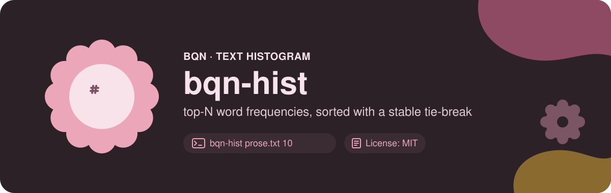

<p align="center">
  
</p>
<p align="center">
  <a href="https://github.com/Celine1337/bqn-hist/releases"></a>
  <a href="https://mlochbaum.github.io/BQN/"></a>
  <a href="LICENSE"></a>
</p>


**bqn-hist** builds a **word-frequency histogram** from the shell, written in [BQN](https://mlochbaum.github.io/BQN/), an array language in the APL family. Give it a text file and it prints the top N words as `count word`, sorted by frequency (descending) with a deterministic alphabetical tie-break. Words are lowercased and basic punctuation is stripped, so `Hello,`, `hello!` and `HELLO` all count as `hello`. It is the quick "what is this document actually about?" tool you reach for before writing a real tokenizer.

Why BQN? Because frequency counting is a textbook array problem: classify the words (`⊐`), group them (`⊔`), tally each group (`≠¨`), then grade (`⍋`/`⍒`) — a few primitives, no loops, no hash-map boilerplate. This repo targets a JVM-based BQN build and avoids float parsing entirely (it is not needed for counting), keeping the tool small, correct and honest about what it does.


- **Top-N word frequencies** — `count word` lines, most frequent first; N defaults to 10.
- **Deterministic ordering** — ties break alphabetically (word ascending), so output is stable across runs.
- **Case & punctuation normalization** — words are lowercased; `.,;:!?()[]{}"'` are stripped.
- **Whitespace splitting** — spaces and tabs separate words; multiple separators collapse.
- **Sensible edge cases** — `topN` is clamped to the number of unique words; `topN 0` and empty files print nothing and exit `0`.
- **Zero dependencies** — one BQN source file; no float parsing, no external libraries.
- **Tested** — a self-contained `test.sh` asserts ordering, tie-breaks, normalization, clamping and exit codes.


Requires a [BQN](https://mlochbaum.github.io/BQN/) interpreter. The launcher targets a JVM-based BQN build at `$TC/bqn/bqn` and puts the toolchain JDK on `PATH`; set `TC` to your toolchain root (defaults to `~/.local/toolchains`).

```bash
git clone https://github.com/Celine1337/bqn-hist.git
cd bqn-hist
./build.sh                     # writes a launcher at bin/bqn-hist
./bin/bqn-hist prose.txt 10
```

Or run the source directly with your BQN binary:

```bash
bqn src/main.bqn prose.txt 10
```


```bash
bqn-hist prose.txt           # top 10 words (default)
bqn-hist prose.txt 3         # top 3 words
bqn-hist prose.txt 0         # print nothing
```

```text
$ printf 'the cat and the dog and the bird\nThe CAT sat on the mat\n' > prose.txt
$ bqn-hist prose.txt 3
5 the
2 and
2 cat
```

`topN` larger than the vocabulary is clamped, and ties always sort alphabetically:

```text
$ printf 'b a b a c\n' > tie.txt
$ bqn-hist tie.txt
2 a
2 b
1 c
```

Exit codes: `0` success (including empty input), `1` error (bad usage, non-numeric `topN`, or unreadable file).


MIT — see [LICENSE](LICENSE).